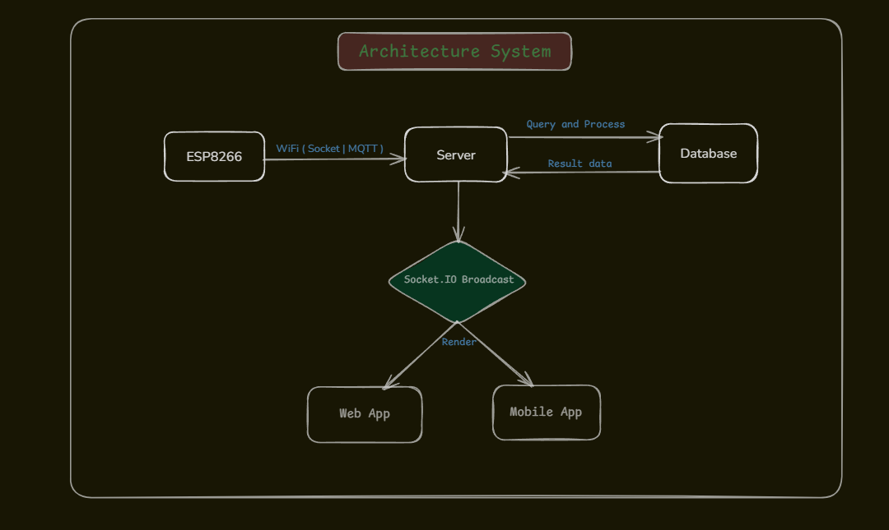
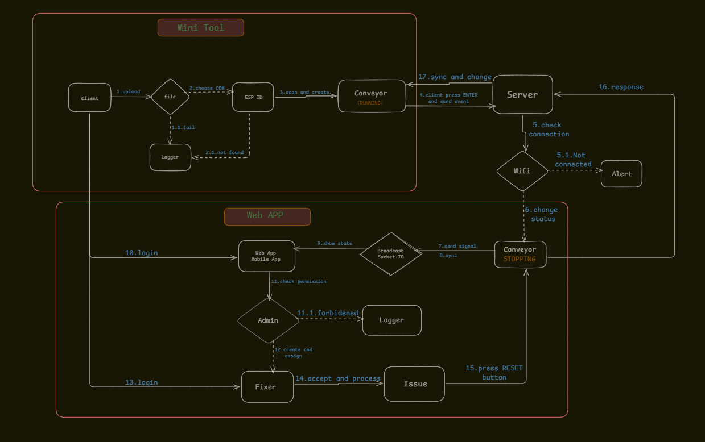

# ANDON Realtime Issue Reporting System 

Hệ thống ANDON báo cáo sự cố theo thời gian thực cho line/máy trong xưởng sản xuất.  
Giải pháp giúp công nhân **báo lỗi nhanh bằng 1 nút**, hiển thị **realtime lên nhiều màn hình**, hỗ trợ **phân công người xử lý**, **reset khi fix xong**, và **lưu log downtime** để phân tích hiệu suất/OEE.
---

## 1. Problem / Bối cảnh
Hiện tại khi có sự cố ở line/máy, công nhân thường:
- Báo miệng / gọi / nhắn tin thủ công
- Dễ chậm trễ, không có log rõ ràng
- Không biết ai đang xử lý, mất thời gian xác nhận

➡️ Dự án xây dựng hệ thống ANDON realtime nhằm:
- ✅ Báo lỗi nhanh bằng **1 nút bấm**
- ✅ Hiển thị **realtime** lên màn hình (nhiều client cùng xem)
- ✅ Admin phân công “ai sửa lỗi”
- ✅ Fix xong bấm **RESET/OK** → hệ thống trở lại bình thường
- ✅ Có **lịch sử sự cố (log)** để thống kê downtime (phục vụ OEE)

---

## 2. Features / Tính năng chính
### Realtime Dashboard
- Hiển thị trạng thái băng chuyền/line: `running` / `stopping`
- Broadcast realtime cho nhiều màn hình (TV/PC/Tablet)
- Xem danh sách sự cố & lịch sử downtime

### Admin Panel
- Quản lý user theo role (Admin / Staff / Fixer / Viewer)
- Phân công người xử lý sự cố (“ai sửa lỗi”)
- Theo dõi tình trạng xử lý

### Hardware One-Button Reporting
- Nút **ENTER/CALL**: báo sự cố ngay lập tức
- Nút **RESET/OK**: xác nhận đã sửa xong → cập nhật `running`
- LED/Buzzer cảnh báo tại chỗ

### Logging & Downtime
- Ghi log sự cố với:
  - `start_time`, `end_time`
  - `factory_id`, `conveyor_id`
  - `status` (`stopping` → `running`)
  - `downtime = end_time - start_time`

---

## 3. System Components / Thành phần hệ thống

### 3.1 Hardware (Andon Station tại máy/line)
- ESP8266 (NodeMCU / Wemos D1 Mini)
- 2 nút nhấn:
  - **ENTER / CALL**: báo lỗi
  - **RESET / OK**: fix xong
- LED / buzzer cảnh báo tại chỗ

### 3.2 Software
**Backend**
- Node.js (API + Realtime)
- Socket.IO (broadcast realtime)
- Auth + Role/Permission

**Frontend**
- ReactJS Web App Dashboard
- Hiển thị realtime cho nhiều client cùng xem

**Database**
- MySQL
- Lưu users + events/log sự cố

---

## 4. Architecture / Kiến trúc tổng quan

---

## 5. Workflow / Luồng hoạt động

## 6. Roles & Permissions / Quyền truy cập
- **Viewer**: chỉ xem dashboard realtime
- **Staff**: báo lỗi (ENTER)
- **Fixer**: xác nhận fix xong (RESET), theo dõi danh sách sự cố
- **Admin**:
  - phân công người xử lý
  - quản lý user/role
  - xem lịch sử & thống kê downtime

---

## 7. Tech Stack
- **Hardware**: ESP8266 (NodeMCU / Wemos D1 Mini), Buttons, (Optional LED/Buzzer)
- **Backend**: Node.js, REST API, Socket.IO (Realtime)
- **Frontend**: ReactJS
- **Database**: MySQL
- **Realtime Protocol**: WebSocket/Socket.IO (hoặc MQTT tùy cấu hình)

---

## 8. Database Design (Suggested)
### `events`
- `id` (PK)
- `factory_id`
- `conveyor_id`
- `status` (`stopping`, `running`)
- `assigned_to` (user_id)
- `start_time`
- `end_time`
- `downtime_seconds`

### `users`
- `id` (PK)
- `name`
- `role` (`admin`, `staff`, `fixer`, `viewer`)
- `username`
- `password_hash`
- `created_at`

---

## 9. Mini Tool (C# WPF) – AES-128 Flashing Utility
Mini tool hỗ trợ người dùng tạo nhiều băng chuyền / cấu hình nhanh mà không cần sửa code.

### Encryption
- AES-128 (mã hoá đối xứng)
- Thành phần:
  - `SECRET_KEY`: key bí mật để mã hoá/giải mã
  - `IV_KEY`: vector khởi tạo (mỗi lần mã hoá output khác nhau, tránh duplicated file)

### Workflow sử dụng tool
1. Chọn file `.enc`
2. Scan COM port và chọn port phù hợp
3. Flash firmware / kiểm tra kết nối
4. Nếu kết nối OK → tạo thông tin conveyor → Done

---

## 10. Mobile App (Planned)
Ứng dụng mobile để theo dõi nhanh hệ thống:
- Xem danh sách băng chuyền
- Xem danh sách sự cố & trạng thái realtime
- Xem danh sách thợ (fixer) / phân công
- Nhận thông báo (push notification) khi có lỗi (planned)

---

## 11. Advantages / Ưu điểm
- ✅ Báo lỗi chỉ 1 nút (nhanh hơn gọi/ghi giấy)
- ✅ Realtime trên nhiều màn hình
- ✅ Tránh “báo rồi nhưng không ai biết”
- ✅ Có lịch sử downtime để phân tích OEE
- ✅ Admin kiểm soát và phân công rõ ràng

---

## 12. Future Improvements
- SLA/Timer cho từng sự cố (cảnh báo quá thời gian)
- QR/Tag cho từng station/conveyor
- Tích hợp notification: Email/Telegram/Zalo/Teams
- Offline queue trên ESP8266 khi mất mạng (store & forward)

---

## License

Copyright © 2026 Vuong

All rights reserved.

This project and its source code may not be copied, modified, or distributed without permission from the author.

Internal / Company use (update as needed).
